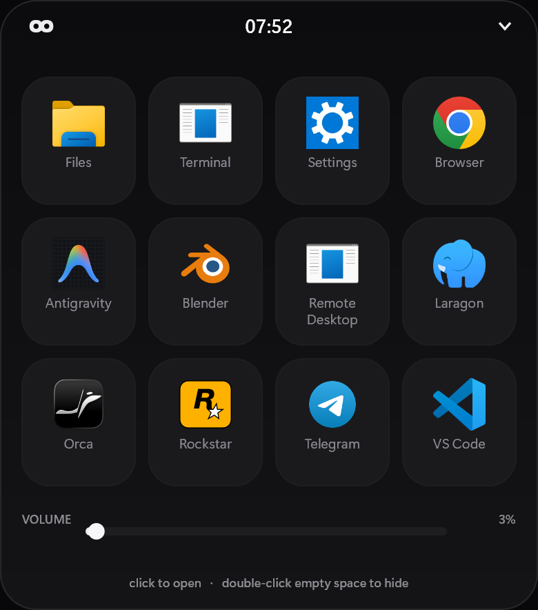
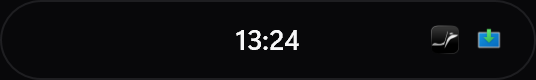
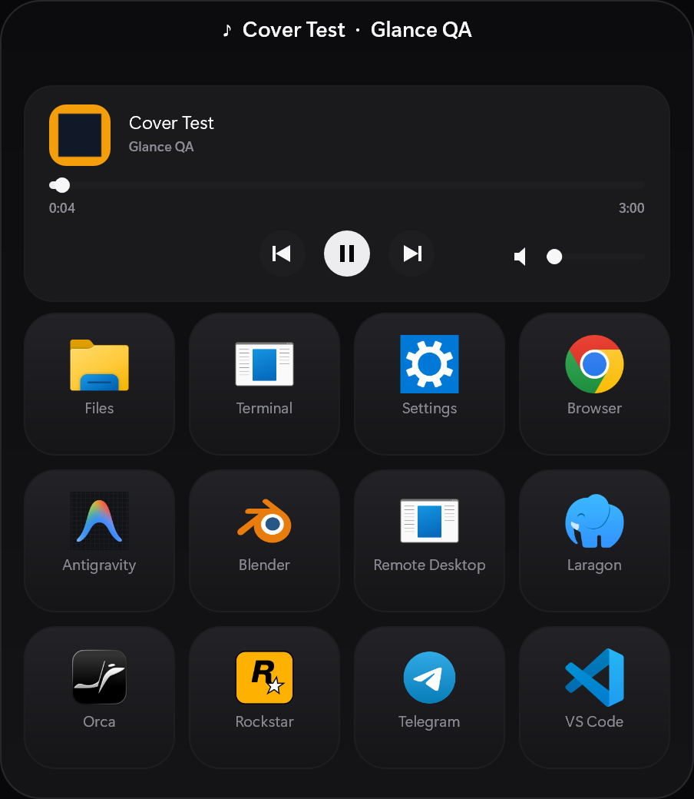

# Glance

A notch at the top of the Windows desktop. Hover it to open, click an app.
Nothing else - no charts, no telemetry dashboard, no account.





## What it does

- **Resting**: a 268 x 40 pill at the top centre. The clock stays exactly on the
  centre line; up to four notification icons anchor to the right edge. Icons are
  dropped from the row rather than allowed to collide with the clock, so the time
  never looks crowded. An icon disappears on its own an hour after the last
  notification from that app; nothing has to be dismissed. While a track plays the title takes the clock's place.
- **Hovering**: grows into a compact panel with one row of the four most-used
  apps, then a **See more (N)** row. The four are one click away; See more opens
  the full 4-column grid. Leaving the panel collapses it, so every hover starts
  the same size.
- **Now playing**: when any player is active (Spotify, browsers, VLC, Groove) a
  card above the grid shows the track, a seekable progress bar with elapsed and
  total time, cover art and prev / play-pause / next centred on the card. While
  it plays, the track name takes over the notch centre.
- **Seek**: click or drag the progress bar to jump anywhere in the track.
- **Volume**: a small slider pinned to the card's right edge, or on its own row
  when nothing plays. Click or drag it, use the wheel, or middle-click to mute.
- **Right-click the island**: hides it. The process keeps running in the tray.
- **Tray icon**: left-click to show/hide, right-click for Show / Exit.
- **Idle strip**: date on the left; battery, unread badges and the volume slider
  on the right. The clock is not repeated there - the notch above already shows it.
- **Battery**: percentage plus a glyph with a bolt while charging. Hidden on a
  machine with no battery, because `BatteryFlag & 128` says so.
- **Notification icons live in the notch.** The notch is the only thing on screen
  while collapsed, so that is where a glance has to land.
- **Notification contents live in the panel.** Hovering the notch - the gesture
  that already opens the panel - reveals up to three rows: app icon, app name,
  the toast text, and how long ago it arrived. Apps that send images only show as
  name plus time.
- **No caption row**: the panel used to spell out "click to open / double-click to
  hide" under the last row. The tiles read as buttons on their own, so the line is
  gone and the panel ends just below the grid.

## Install

```bat
build.bat
copy build\glance.exe "%LOCALAPPDATA%\Programs\Glance\Glance.exe"
```

`build.bat` links `-static`, so the exe carries libstdc++, libgcc and
libwinpthread inside it. Its only imports are Windows system DLLs
(`d2d1`, `DWrite`, `dwmapi`, `pdh`, `user32`, ...), which means it can be copied
to another machine on its own - no MinGW runtime, no VC++ redistributable.

A Desktop shortcut and a Start Menu entry named **Glance** point at that copy, so
rebuilding the project never breaks them.

## Editable app list

`src/launcher.cpp`, the `candidates` array. Each entry is

```cpp
{L"Tile label", L"launch target", L"optional icon source"},
```

- `target` accepts an executable, a `%VAR%` path, a name on `PATH`, or a shell URI
  such as `ms-settings:`.
- Any entry whose target cannot be resolved is dropped at startup, so a machine
  without Windows Terminal simply shows one tile fewer instead of a dead button.
- The optional third field exists for shell URIs, which have no icon of their own:
  `{"Settings", "ms-settings:", "%SystemRoot%\\ImmersiveControlPanel\\SystemSettings.exe"}`.

The panel height is derived from the number of resolved apps, so the grid never
leaves a half-empty row.

## Design decisions

| Choice | Why |
|---|---|
| 4 columns | 12 entries fill three even rows. The panel is 452 dip wide, so four tiles still read as buttons rather than chips. |
| Tile fill is a soft vertical gradient | A flat `#1A1A1D` fill went muddy beside 38 px colour icons. The gradient tops out at `#232327`, which reads as a lit surface without adding a second colour to the palette. |
| `IShellItemImageFactory`, 256 px | `SHGetFileInfo` caps at 32 px and looked soft in a 44 px tile. |
| Icons drawn on transparent alpha | Icon bitmaps have real transparency; ignoring it produced black squares. |
| Collapse on a 300 ms timer with a cursor re-check | Resizing during the expand animation fires `WM_MOUSELEAVE` even while the pointer is inside, which made the panel flicker. |
| Process scan only while expanded | Enumerating every PID cost ~2% CPU per second; the notch does not need the process list. |
| Idle strip shows the clock | With no track the strip used to read only "VOLUME" over a mostly empty 452 dip row. The clock and date were already in the snapshot, so they fill it instead of adding a new data source. |
| Cover art as pixels, decoded through WIC | `Thumbnail` returns an `IRandomAccessStreamReference`, so reading it means open-stream -> read-buffer -> decode. Doing that in the render path would block a frame, so it runs one async step per tick and the result is kept as a 96 px BGRA buffer, not a device bitmap - the panel paints to both the window and the snapshot bitmap. |
| Cached cover bitmap is discarded with its render target | A device bitmap is owned by the target that created it. The cache compared `artTarget_` against the live target, so a fresh target could be allocated at the same address as a released one and the stale bitmap would be reused. `discardRenderTarget()` and the snapshot teardown now both call `Scene::discardArtBitmap()` first. |
| `WM_CAPTURECHANGED` clears the drag | Capture can be taken away mid-drag (Alt+Tab, another window, a shell overlay). The drag flag gates the 1 Hz media refresh, so a stolen capture used to freeze the card until restart. |
| Notifications read from `wpndatabase.db`, not the notification API | `UserNotificationListener` reports `GetAccessStatus = Allowed` here, but `GetNotificationsAsync` never completes (measured: status stayed `Started` for 10 s). Unpackaged processes cannot use it; shipping needs an MSIX identity. The store is opened read-only in WAL mode, so a live reader neither blocks the service nor misses recent rows. Only two columns are read: `Handler.PrimaryId` and `Notification.ArrivalTime`. Content is never touched. |
| Icon from `shell:AppsFolder\<AUMID>` | Packaged apps expose their real icon through the shell namespace even though the calling process is unpackaged. Verified on WhatsApp, Snipping Tool and Orca AUMIDs; system toast handlers such as `Print.PrinterCleanupTask` have no entry and fall back to no icon rather than a generic square. |
| Four quick tiles, not a single folder row | A folder row made every app cost an extra click, including the one opened every hour. Four tiles are the same width as the panel's single row and keep the common case at one click; the count moves into the See more label, where it is a fact about the hidden set rather than decoration. |
| `drawLauncherGrid` takes a `limit` | The same code draws the one-row preview and the full grid. A limit, rather than a second renderer, means tile rects, hover state and hit testing cannot drift between the two modes. |
| Apps grid behind one folder row | Twelve tiles needed 440 dip - 52% of a 1080p work area - and the panel is opened dozens of times a day. A single row cuts the resting panel to 354 dip. The cost is one extra click; the alternative (6 columns) broke labels like "Remote Desktop" into unreadable fragments, and 5 columns did not reduce the row count at all. |
| Folder reveal resizes instantly, not animated | The animated path resizes the window repeatedly and each resize fires `WM_MOUSELEAVE`, which schedules a collapse - and collapsing resets the folder. One instant resize has neither problem and cannot be undone by a stray mouse event. |
| Clock centred, icons anchored right | Centring clock+icons as one group moved the time off-centre whenever a badge appeared, which read as cramped. The clock now sits on the centre line and the icon row hangs off the right edge, capped by a measured check that drops icons until they clear. |
| Notch widened to 268 dip | Four 15 px icons plus gaps need the room; at 236 the group overlapped the clock. |
| Icons expire after 60 minutes, no dismissal gesture | Every mouse gesture on the notch is already taken: movement expands the panel, right-click hides the island, middle-click mutes, and the left-drag area belongs to the volume and seek sliders. A click target on the 40 px pill would also fire *after* the panel had already opened. Time-based expiry needs no gesture, cannot be triggered by accident, and matches what an ambient indicator should be - a hint about the recent past, not a queue to manage. |
| Badges in the notch, not the panel | Measured: the panel is invisible while collapsed, which is most of the time. Putting the icons next to the clock makes them readable at a glance; the panel keeps the date, battery and volume. |
| Notification text parsed from the toast payload | Toasts are XML binding documents; every visible string sits in a `<text>` element, sometimes wrapped in `<run>`/`<span>`. Tags are stripped rather than parsed structurally because the schema differs per app. Netflix and Widgets send images with no text at all, so those rows fall back to name and age. |
| Notification count is not the unread count | The store counts toast *arrivals*, which is history: Orca showed 10 arrivals but zero unread. Only "has something recent" is taken from it. The number drawn next to a logo comes from the app's own title, where it means actual unread. Zero counts are not drawn at all - a row of "0"s was the first thing the screenshot showed. |
| Vendored SQLite, `SQLITE_THREADSAFE=0` | No system SQLite on Windows, and the panel is single-threaded, so the smaller build is the correct one. Compiled once into `build/sqlite3.o` and reused. |
| Ambient icons rebuilt per render target | Same pattern as the launcher: WIC sources are kept, D2D bitmaps are recreated when the target changes. The snapshot target and the window target are different objects, so sharing one bitmap would be a use-after-free. |
| `GLANCE_FAKE_BATTERY` override | This machine is a desktop with no battery, so the battery glyph could not be checked otherwise. Format `<percent>` or `<percent>,charging`. Diagnostics only. |
| COM apartment is MTA | The art chain is four nested WinRT async operations. In an STA those completions are delivered through the thread's message queue, which `--snapshot` never pumps, so the art silently never arrived there. The app uses no STA-only API, so MTA is both simpler and correct. |
| SMTC read through hand-written COM vtables | The SDK's `windows.media.control.h` needs MSVC (`_uuidof`, WRL version gates) and will not parse under MinGW. Slot order is copied from the SDK header and noted in `media.cpp`; `IAsyncInfo` is reached by QueryInterface, not by inheriting `IAsyncOperation`. |
| Volume lives in the media strip | A separate band under the grid pushed the tiles down and split one audio control surface across two places; player bars put transport and volume on one line. |
| Transport centred, volume small and right | With the panel widened to 452 dip the controls clear each other by a wide margin, so the buttons stay on the card's centre line instead of being clamped left. |
| Position extrapolated from `LastUpdatedTime` | Players refresh the timeline every few seconds at best, so the raw `Position` sat frozen and then jumped. SMTC stamps each sample with the instant it was true; the panel advances from that anchor and only corrects when a new sample lands. |
| Seek writes a local position first | `TryChangePlaybackPositionAsync` is fire-and-forget; without moving the local snapshot the bar snapped back for the ~2 s the player took to confirm. |
| Volume and track polled on the 1 Hz timer | Both change from outside the app (hardware keys, the Windows overlay, the player). Polling only on scroll/click left the slider showing stale state that looked broken. |
| Track polled at 1 Hz, not subscribed | Event handlers would need reference-counted `ITypedEventHandler` objects; one extra getter per second costs nothing and keeps the process free of COM callbacks that outlive the window. |

## Measured

| Metric | Value |
|---|---|
| Binary | 764 KB |
| Working set | ~55 MB |
| CPU, 10 s idle collapsed | 0.016 s (~0.16%) |

## Layout

```
src/
  main.cpp       window, tray, hover state machine, paint loop, PNG snapshot
  scene.cpp      all Direct2D drawing and DirectWrite text
  telemetry.cpp  clock only in collapsed mode; CPU/RAM/disk/net primitives remain
  launcher.cpp   target resolution, icon extraction, ShellExecute
  media.cpp      now-playing through the System Media Transport Controls
resources.rc     embeds assets/app.ico as resource 101
assets/app.ico   tray and window icon (mint eyes on a dark rounded square)
```

## Known limits

- Clicking a tile has not been verified by an automated harness (tool windows
  cannot receive synthetic clicks there). Verified manually.
- Single monitor: position follows `SPI_GETWORKAREA`.
- Cover art appears one to two seconds after a track starts: the chain needs four
  round trips through the player. A player that offers no thumbnail keeps the
  placeholder note glyph.
- Badges need the notification store to exist. On a fresh profile with no
  notifications yet, the row is simply absent.
- Counts only appear for apps that publish a number in their title. A
  browser tab does not, so web WhatsApp shows nothing until its desktop app is
  installed.
- Seek needs a duration. Live streams report none, so the bar renders as a plain
  track with `--:--` and refuses clicks rather than seeking nowhere.
- No installer, no auto-start entry. Both are one-line additions if wanted.
